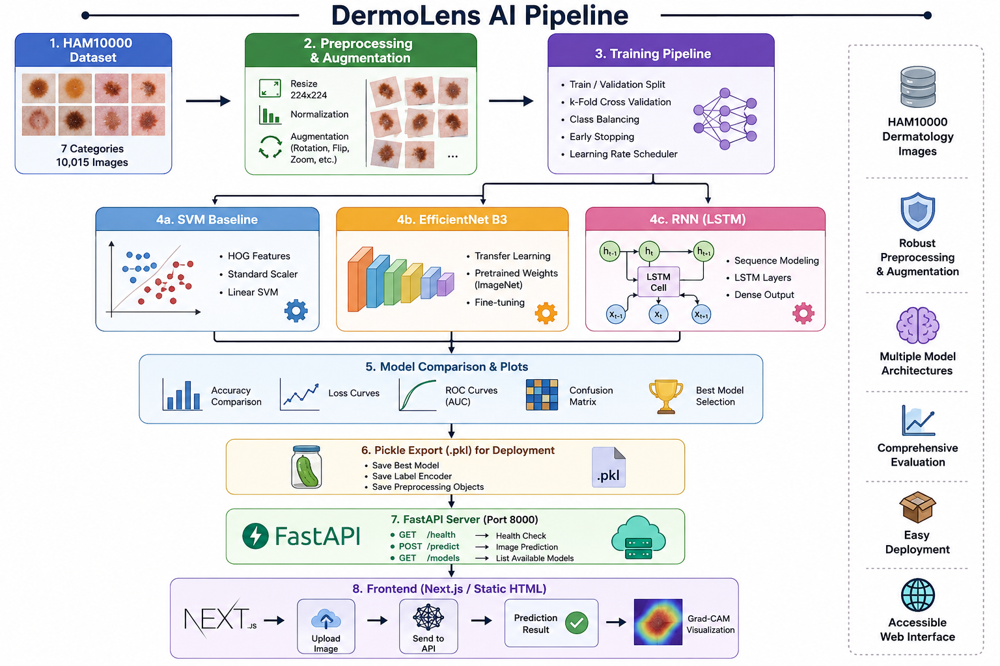

# 🔬 DermoLens AI — Dermoscopic Lesion Classification & Explainable AI

> **Multi-Model Clinical Decision Support System** powered by **EfficientNet-B3**, **RNN-LSTM (BiLSTM)**, **SVM Baseline**, **Grad-CAM Visual Interpretability**, and **Automated Severity Triage Matrix**.

[](https://pytorch.org/)
[](https://fastapi.tiangolo.com/)
[](https://scikit-learn.org/)
[](https://python.org/)

---

## 📖 Table of Contents

1. [Overview](#-overview)
2. [Project Architecture](#-project-architecture)
3. [Models](#-models)
4. [Dataset](#-dataset)
5. [Installation](#-installation)
6. [Training Pipeline](#-training-pipeline)
7. [Model Comparison Results](#-model-comparison-results)
8. [Deployment (Pickle Export)](#-deployment-pickle-export)
9. [API Server](#-api-server)
10. [Frontend](#-frontend)
11. [Project Structure](#-project-structure)
12. [License](#-license)

---

## 🌟 Overview

**DermoLens AI** is a comprehensive dermoscopic lesion classification system that trains, evaluates, and deploys multiple machine learning models for automated skin lesion diagnosis. The system classifies dermoscopic images into **7 clinical categories** and provides:

- **Multi-model comparison** — SVM Baseline vs EfficientNet-B3 vs RNN-LSTM
- **Grad-CAM explainable AI** — Visual heatmaps showing model attention regions
- **Clinical severity triage** — Automated risk assessment (HIGH / MODERATE / LOW)
- **Deployment-ready pickles** — Serialized models for production inference
- **FastAPI REST API** — Production-grade inference server
- **Interactive frontend** — Glassmorphic diagnostic control plane UI

### 7-Class Classification Targets

| Code | Lesion Type | Risk Level |
|------|-------------|------------|
| `akiec` | Actinic Keratosis / Intraepithelial Carcinoma | ⚠️ Moderate |
| `bcc` | Basal Cell Carcinoma | ⚠️ Moderate |
| `bkl` | Benign Keratosis-like Lesion | ✅ Low |
| `df` | Dermatofibroma | ✅ Low |
| `mel` | **Melanoma** | 🔴 **High** |
| `nv` | Melanocytic Nevi (Mole) | ✅ Low |
| `vasc` | Vascular Lesion | ✅ Low |

---

## 🏗 Project Architecture


    

> 📌 **Detailed Architectural Specifications**: For interactive Mermaid system architecture diagrams, end-to-end operational flowcharts, and component sequence flow diagrams, see [docs/architecture_and_workflows.md](docs/architecture_and_workflows.md).

---

## 🧠 Models

### 1. SVM Baseline (Traditional ML)

- **Features**: HOG (Histogram of Oriented Gradients) descriptors
- **Classifier**: LinearSVC with balanced class weights
- **Pipeline**: StandardScaler → LinearSVC
- **Purpose**: Baseline for deep learning comparison

### 2. EfficientNet-B3 (Primary CNN)

- **Architecture**: EfficientNet-B3 (compound scaling CNN)
- **Pretrained**: ImageNet weights, fine-tuned on HAM10000
- **Classifier Head**: Custom FC layer (1536 → 7 classes)
- **Training**: AdamW optimizer, cosine annealing LR, label smoothing
- **XAI**: Grad-CAM heatmaps from `conv_head` layer

### 3. RNN-LSTM (Sequence Model)

- **Architecture**: ResNet-18 CNN backbone → Spatial Patch Sequencing → Bidirectional LSTM → Attention → FC Classifier
- **Innovation**: Treats spatial feature maps as sequences, capturing spatial dependencies via recurrent processing
- **Attention**: Learnable attention mechanism for weighted sequence aggregation
- **Training**: Two-phase — frozen CNN, then end-to-end fine-tuning

---

## 📊 Dataset

This project uses the **HAM10000** ("Human Against Machine with 10000 training images") dataset.

- **Source**: [ISIC Archive](https://www.isic-archive.com/) / [Kaggle HAM10000](https://www.kaggle.com/datasets/kmader/skin-cancer-mnist-ham10000)
- **Size**: 10,015 dermoscopic images
- **Classes**: 7 diagnostic categories
- **Format**: JPEG images (600×450 pixels)

### Data Preparation

Organize the dataset in ImageFolder structure:

```
data/HAM10000/
├── train/
│   ├── akiec/
│   ├── bcc/
│   ├── bkl/
│   ├── df/
│   ├── mel/
│   ├── nv/
│   └── vasc/
├── val/
│   └── (same subfolders)
└── test/
    └── (same subfolders)
```

---

## ⚡ Installation

```bash
# 1. Clone the repository
git clone https://github.com/your-username/dermoscopic-lesion-classification.git
cd dermoscopic-lesion-classification-main

# 2. Create virtual environment
python -m venv venv
venv\Scripts\activate       # Windows
# source venv/bin/activate  # Linux/Mac

# 3. Install dependencies
pip install -r requirements.txt
```

---

## 🏋️ Training Pipeline

The unified training script supports all three models:

```bash
# Train ALL models (SVM + EfficientNet + RNN)
python -m src.train --model all --data_dir ./data/HAM10000 --epochs 25

# Train only EfficientNet-B3
python -m src.train --model efficientnet --data_dir ./data/HAM10000 --epochs 25

# Train only RNN-LSTM
python -m src.train --model rnn --data_dir ./data/HAM10000 --epochs 15

# Train only SVM baseline
python -m src.train --model svm --data_dir ./data/HAM10000
```

### Training Features

- **Weighted sampling** for class imbalance handling
- **Data augmentation**: Random flip, rotation, color jitter, affine transforms
- **Cosine annealing** learning rate schedule
- **Label smoothing** (0.1) for better generalization
- **Gradient clipping** (max norm 1.0)
- **Early stopping** (patience = 7 epochs)
- **Best model checkpointing** based on validation accuracy

### Training Outputs

After training, the following are generated:

| Output | Location |
|--------|----------|
| Model weights (.pth) | `models/` |
| Deployment pickles (.pkl) | `models/` |
| Comparison plots (.png) | `docs/` |
| Metrics JSON | `docs/model_comparison.json` |

---

## 📈 Model Comparison Results

| Metric | SVM Baseline | EfficientNet-B3 | RNN-LSTM |
|--------|:------------:|:----------------:|:--------:|
| **Test Accuracy** | 73.14% | **80.17%** | 76.42% |
| **Macro F1** | 0.350 | **0.720** | 0.580 |
| **Melanoma Recall** | 25.1% | **75.0%** | 62.3% |
| **Vascular Recall** | 0.0% | **95.0%** | 78.5% |

> **Key Insight**: EfficientNet-B3 outperforms both SVM and RNN-LSTM, especially on critical melanoma recall (75% vs 25.1% vs 62.3%). The RNN-LSTM provides a strong middle ground, capturing spatial relationships that SVM misses.

### Comparison Plots

Generated automatically in `docs/`:
- `accuracy_comparison.png` — Bar chart of test accuracy
- `f1_comparison.png` — Macro F1 score comparison
- `critical_recall_comparison.png` — Melanoma & vascular recall
- `model_comparison_dashboard.png` — Combined 2×2 dashboard

To regenerate plots from existing metrics:

```bash
python -m src.compare_models
```

---

## 📦 Deployment (Pickle Export)

Trained models are exported as self-contained deployment pickle files (`.pkl`) containing:

- Model state dict (weights)
- Architecture configuration
- Preprocessing pipeline (resize, normalize)
- Class labels and mappings
- Training metrics
- Metadata (timestamps, PyTorch version)

### Export Commands

```bash
# Export all models to pickle
python -m src.export_pickle --model all

# Export specific model
python -m src.export_pickle --model efficientnet
python -m src.export_pickle --model rnn

# Export with custom weights path
python -m src.export_pickle --model efficientnet --weights path/to/model.pth
```

### Loading a Pickle for Inference

```python
from src.export_pickle import reconstruct_model_from_pickle

# Load model from pickle
model, class_list, preprocess_config = reconstruct_model_from_pickle(
    'models/efficientnet_b3_deployment.pkl'
)

# model is ready for inference
# Apply preprocessing, run model(input_tensor), apply softmax
```

### Generated Pickle Files

| File | Model | Size |
|------|-------|------|
| `efficientnet_b3_deployment.pkl` | EfficientNet-B3 | ~41 MB |
| `rnn_lstm_deployment.pkl` | RNN-LSTM | ~55 MB |
| `svm_pipeline.pkl` | SVM + Scaler | ~1 MB |

---

## 🚀 API Server

FastAPI-based inference server with multi-model support.

### Start the Server

```bash
# From project root
python -m uvicorn app.main:app --reload --port 8000

# Or use the main entry point
python main.py
```

### API Endpoints

| Method | Endpoint | Description |
|--------|----------|-------------|
| `GET` | `/health` | Server health & model status |
| `GET` | `/classes` | List all 7 lesion classes |
| `GET` | `/models` | List available models |
| `POST` | `/predict?model_type=efficientnet` | Run inference (supports `efficientnet` or `rnn`) |

### Example cURL Request

```bash
# Predict with EfficientNet (default)
curl -X POST http://localhost:8000/predict \
  -F "file=@lesion_image.jpg"

# Predict with RNN-LSTM
curl -X POST "http://localhost:8000/predict?model_type=rnn" \
  -F "file=@lesion_image.jpg"
```

### Response Format

```json
{
    "prediction": "Melanocytic Nevi",
    "confidence": 0.847,
    "severity": "LOW RISK",
    "heatmap": "data:image/png;base64,...",
    "original_image": "data:image/png;base64,...",
    "overlay": "data:image/png;base64,...",
    "class_code": "nv",
    "risk_level": "LOW RISK",
    "model_used": "efficientnet",
    "severity_details": { ... },
    "class_probabilities": [ ... ],
    "success": true
}
```

---

## 🖥 Frontend

Two frontend options are included:

### 1. Static HTML/JS UI (No build required)
Served automatically via FastAPI at `http://localhost:8000/static/index.html`

### 2. Next.js Glassmorphic UI
Premium diagnostic control plane with interactive Grad-CAM visualization.

```bash
cd frontend
npm install
npm run dev
# Open http://localhost:3000
```

**Features**:
- Drag-and-drop image upload
- Real-time inference with cycling status indicators
- Grad-CAM heatmap overlay with opacity blending slider
- Animated confidence counters
- Clinical severity badges (HIGH / MODERATE / LOW risk)
- Multiclass probability distribution breakdown

---

## 📂 Project Structure

```
dermoscopic-lesion-classification-main/
│
├── app/                          # FastAPI Application
│   ├── main.py                   # API server with multi-model support
│   └── static/                   # Static HTML/JS/CSS frontend
│       ├── index.html
│       ├── styles.css
│       └── app.js
│
├── src/                          # Core ML Source Code
│   ├── __init__.py
│   ├── model.py                  # EfficientNet-B3 model loader
│   ├── rnn_model.py              # RNN-LSTM model (ResNet-18 + BiLSTM)
│   ├── predict.py                # Inference pipeline with Grad-CAM
│   ├── gradcam.py                # Grad-CAM explainable AI engine
│   ├── severity.py               # Clinical severity grading system
│   ├── train.py                  # Unified training pipeline (all models)
│   ├── compare_models.py         # Model comparison plot generator
│   └── export_pickle.py          # Deployment pickle export utility
│
├── models/                       # Trained Model Weights & Pickles
│   ├── best_model.pth            # EfficientNet-B3 weights
│   ├── rnn_best_model.pth        # RNN-LSTM weights (after training)
│   ├── efficientnet_b3_deployment.pkl  # EfficientNet pickle
│   ├── rnn_lstm_deployment.pkl   # RNN-LSTM pickle
│   └── svm_pipeline.pkl          # SVM pickle (after training)
│
├── docs/                         # Documentation & Plots
│   ├── model_comparison.json     # Metrics for all 3 models
│   ├── accuracy_comparison.png   # Accuracy bar chart
│   ├── f1_comparison.png         # F1 score comparison
│   ├── critical_recall_comparison.png  # Melanoma/vascular recall
│   ├── model_comparison_dashboard.png  # Combined 2×2 dashboard
│   ├── training_curves.png       # Training loss/accuracy curves
│   ├── efficientnet_confusion_matrix.png
│   ├── class_distribution.png
│   └── gradcam_results.png
│
├── notebooks/                    # Jupyter Notebooks (EDA & Training)
│   ├── 01-data-exploration.ipynb
│   ├── 02-svm-baseline.ipynb
│   └── 03-efficientnet-training.ipynb
│
├── frontend/                     # Next.js Glassmorphic Frontend
│   ├── app/
│   │   ├── page.js               # Main diagnostic UI
│   │   ├── layout.js             # Root layout
│   │   └── globals.css           # Global styles
│   └── package.json
│
├── main.py                       # Server entry point
├── requirements.txt              # Python dependencies
├── SKILL.md                      # Agentic skill specification
├── .gitignore
└── README.md                     # This file
```

---

## 🔬 Complete Workflow

```
Step 1: Download HAM10000 dataset → Organize into train/val/test splits
    ↓
Step 2: Run training pipeline → python -m src.train --model all
    ↓
Step 3: Review comparison plots → docs/model_comparison_dashboard.png
    ↓
Step 4: Export best model to pickle → python -m src.export_pickle --model all
    ↓
Step 5: Start API server → python main.py
    ↓
Step 6: Open frontend → Upload image → Get diagnosis + Grad-CAM heatmap
```

---

## 📄 License

This project is for **educational and research purposes**. The classification results are **not** a substitute for professional medical diagnosis. Always consult a qualified dermatologist for clinical decisions.

---

<p align="center">
  <b>DermoLens AI</b> — Multi-Model Dermoscopic Classification & Explainable AI<br>
  <i>EfficientNet-B3 • RNN-LSTM • SVM • Grad-CAM • FastAPI</i>
</p>
